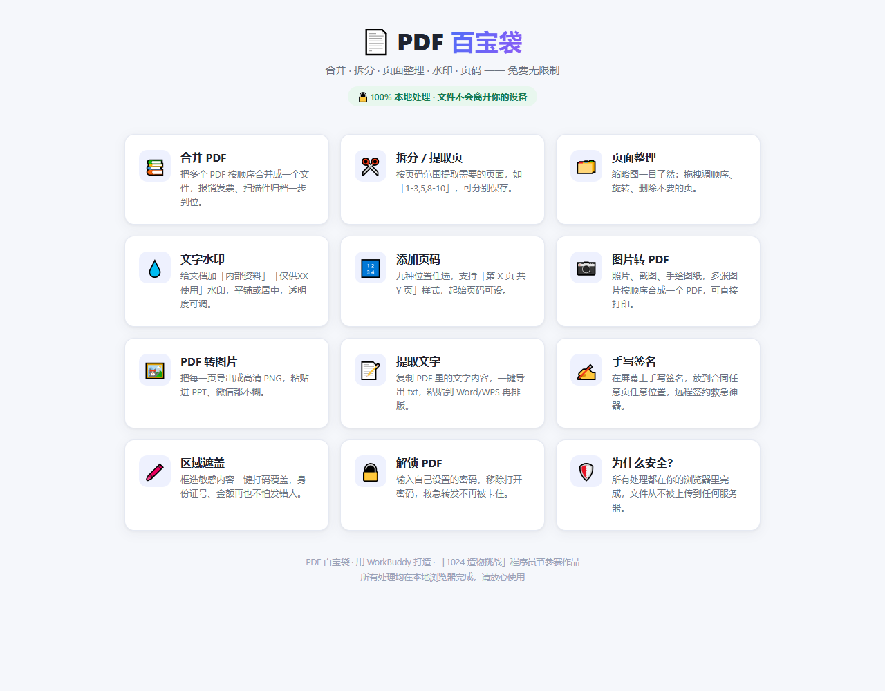
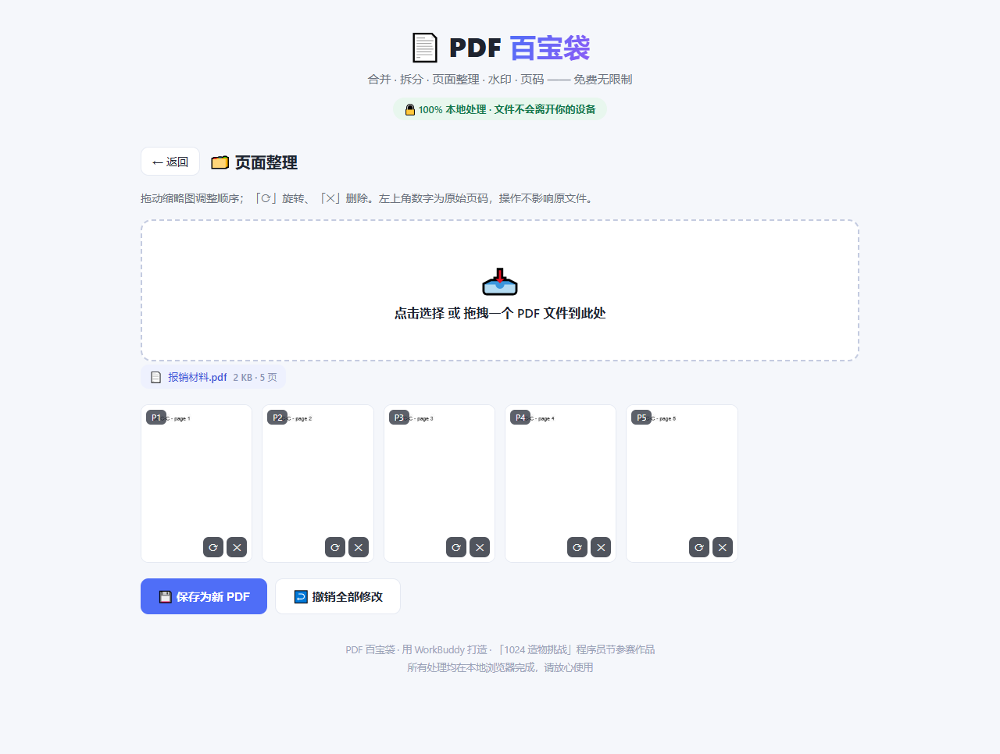
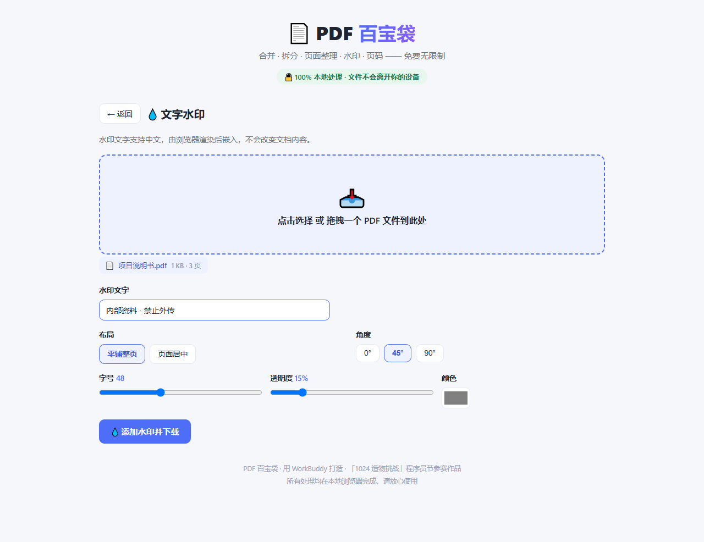
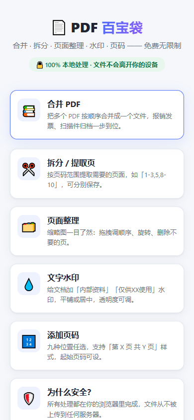

# PDF 百宝袋 · PDF Toolbox

> 浏览器里的**本地** PDF 工具箱 —— 合并、拆分、页面整理、水印、页码、OCR、手写签名、遮盖、解锁、批量处理，**12 个工具一个网页搞定**。
>
> 🔒 所有处理 **100% 在你自己的浏览器里完成**，文件不上传任何服务器。免费、不限次数、无需注册。



---

## 为什么做这个

几乎每个人每周都会碰到 PDF 小事：

- 报销时把几张发票合并成一个文件
- 打印前只想提取其中几页（"1-3,5"）
- 给合同加上"内部资料 · 禁止外传"水印
- 给论文/标书标上"第 X 页 / 共 Y 页"
- 扫描件里的文字提不出来，想 OCR
- 对方发来的 PDF 有密码打不开
- 远程签合同，手边没打印机

市面上的在线工具几乎都有两个通病：**要么把文件传到别人的服务器**（发票、合同、身份证扫描件谁敢传？），**要么限次数、要开会员**。

「PDF 百宝袋」的出发点就是把付费 PDF 工具的三个收费点 —— **质量差距（OCR）、限制解锁（批量/水印/页数）、救急场景（签名/解密）** —— 全部做成免费，同时坚持一件事：**文件永不上传**。

## 功能一览

| # | 工具 | 说明 |
|---|------|------|
| 1 | **合并 PDF** | 多文件拖拽排序，一键合并 |
| 2 | **拆分 / 提取页** | 支持 `1-3,5,8-10` 区间语法，可合并为一个文件或分段单独下载 |
| 3 | **页面整理** | 缩略图网格，拖拽调序、旋转、删除、一键撤销 |
| 4 | **文字水印** | 支持中文，平铺 / 居中，角度、字号、透明度、颜色可调 |
| 5 | **添加页码** | 九个位置、五种样式（含"第 X 页 / 共 Y 页"），起始页码与边距可调 |
| 6 | **图片转 PDF** | JPG / PNG / WebP 按顺序合成，A4 自适应打印或原图尺寸存档 |
| 7 | **PDF 转图片** | 每页导出 1x / 1.5x / 2x 高清 PNG，粘进 PPT / 微信不糊 |
| 8 | **提取文字 + OCR** | 普通 PDF 直接提取；扫描件用内置 Tesseract 中文 OCR 识别，可复制 / 导出 txt |
| 9 | **手写签名** | 屏幕手写签名，指定页或全部页任意位置，远程签约救急 |
| 10 | **区域遮盖** | 预览图上框选即打码，身份证号 / 敏感信息发送前一键遮盖 |
| 11 | **解锁 PDF** | 凭打开密码移除密码保护，生成无密码新文件 |
| 12 | **批量水印** | 一次给多个文件应用同一水印，逐一下载 |

每个工具面板都附有**使用小贴士**（场景化操作指引），手机端同样可用。

<details>
<summary>更多截图</summary>

**页面整理（缩略图拖拽重排）**



**中文水印面板**



**移动端适配**



</details>

## 隐私：文件到底去了哪里

**哪儿也没去。**

所有 PDF 的解析、渲染、编辑、导出，全部由浏览器内的 JavaScript 库在本地完成。工具箱**没有任何后端接口**，没有文件上传、没有分析统计上报、没有账号体系。断网状态下，除首次加载 OCR 语言包外（语言包已内置在仓库里），所有功能依然可用。

这在处理合同、发票、身份证、银行流水这类文件时，是最实际的价值。

## 技术实现

- **PDF 解析 / 页面操作** —— [pdf-lib](https://pdf-lib.js.org/) + [pdf.js](https://mozilla.github.io/pdf.js/)，浏览器端完成
- **渲染预览** —— pdf.js worker 线程渲染，缩略图网格交互式重排
- **水印 / 页码 / 签名** —— Canvas 渲染后嵌入 PDF，因此**支持中文且无需打包字体**
- **OCR** —— [Tesseract.js](https://tesseract.projectnaptha.com/) v4，中文语言包（`chi_sim`）已本地化内置
- **交付形态** —— 纯静态单页应用，无构建步骤、无后端、无依赖安装

### 第三方依赖（已本地化，见 `vendor/`）

| 文件 | 用途 |
|------|------|
| `pdf-lib.min.js` | PDF 读写与页面操作 |
| `pdf.min.js` / `pdf.worker.min.js` | PDF 渲染与文本提取 |
| `tesseract.min.js` / `tesseract-worker.min.js` / `tesseract-core.wasm.js` | OCR 引擎（WebAssembly） |
| `vendor/langs/chi_sim.traineddata.gz` | 中文 OCR 语言包（约 20MB） |

## 本地运行

不需要任何构建步骤，**双击 `index.html` 就能用**。

不过部分浏览器对 `file://` 协议有限制（尤其是 Worker / WASM），推荐起个本地静态服务器：

```bash
# 任选其一
python -m http.server 8000
npx serve .
```

然后打开 <http://localhost:8000>。

## 部署

纯静态站点，可部署到任意静态托管：

- **GitHub Pages** —— 本仓库已内置 `.github/workflows/deploy.yml`，推送到 `main` 分支即自动发布
- **Vercel / Netlify / Cloudflare Pages** —— 导入仓库，无需构建命令，发布目录为仓库根目录

> 注意：`vendor/langs/chi_sim.traineddata.gz` 约 20MB，首次 OCR 加载需要一点时间。部署平台若限制单文件体积，OCR 可改走 CDN（把 `index.html` 中 `langPath` 指向 Tesseract 官方 CDN 即可）。

## 浏览器支持

Chrome / Edge / Firefox / Safari 的近两年版本均可。移动端 Safari 与 Chrome 已适配。

## 参与 1024 造物挑战

本项目是参加「1024 造物挑战」的作品，形态为**网页应用**。

- 作品名称：PDF 百宝袋
- 作品宣言：这个 1024，我做了一个把 OCR、批量水印、手写签名、解锁这些「付费功能」全部免费的 PDF 工具箱，让每个打工人不用上传隐私文件、不用开会员，在浏览器里就能搞定所有 PDF 难题。

## 许可

MIT License，详见 [LICENSE](LICENSE)。

第三方依赖各自遵循其原始许可协议（pdf-lib / pdf.js / Tesseract.js 均为 Apache-2.0 或 MIT 类许可）。
